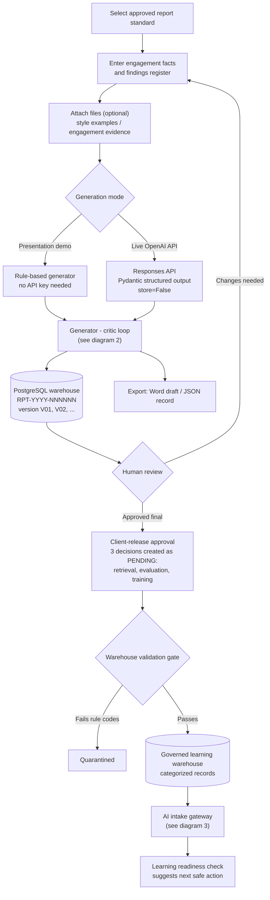
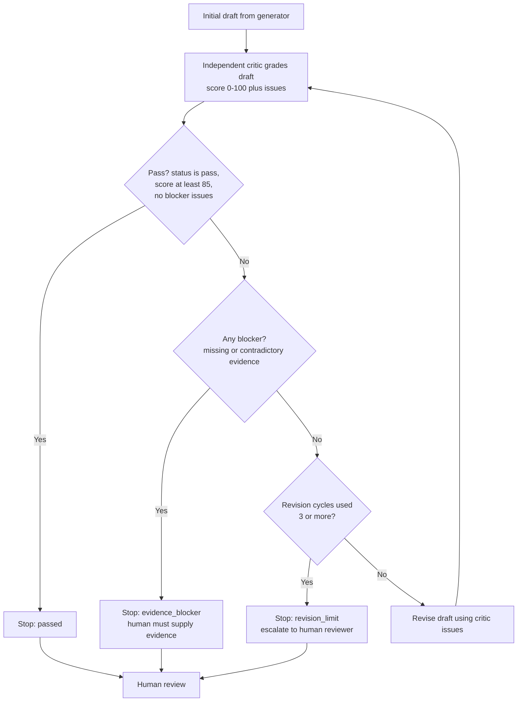
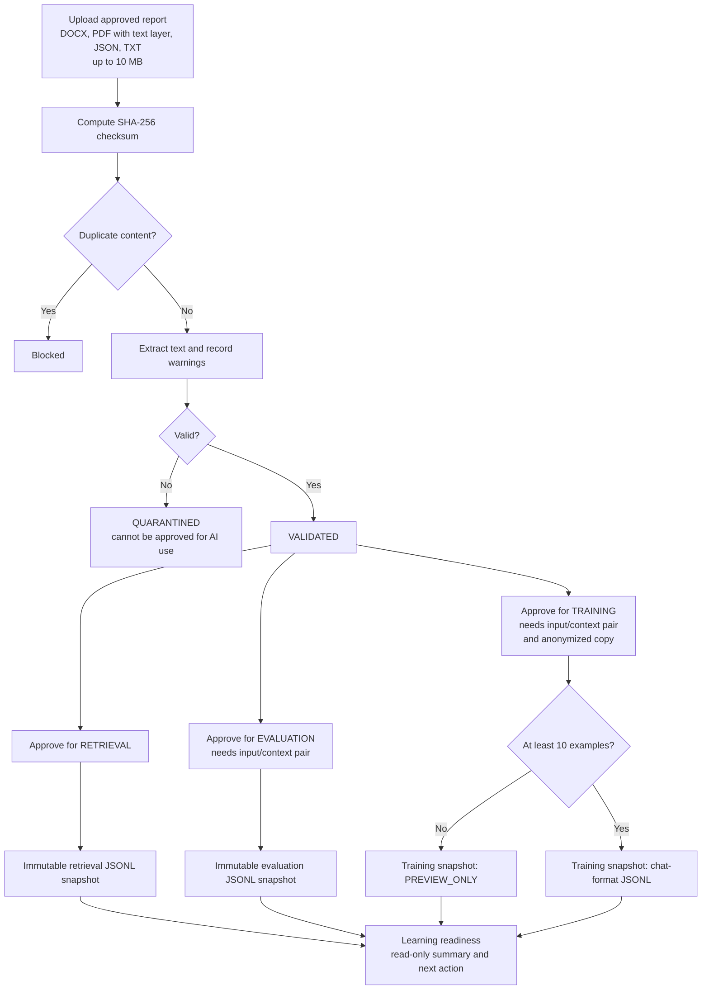

# Audit Automation Pipeline

Audit Automation Pipeline is a prototype for creating reviewable audit and assurance report drafts. It demonstrates a controlled workflow rather than an open-ended chatbot:

1. Select an approved report standard.
2. Enter engagement facts and findings.
3. Optionally attach approved style examples and engagement evidence.
4. Generate a structured draft.
5. Automatically grade and revise it up to three times with an independent critic engine.
6. Stop on evidence blockers or require an 85/100 score, then complete human review.
7. Transfer only the human-approved final report into the categorized learning warehouse.
8. Stage approved examples through a controlled AI-intake gateway.
9. Approve retrieval, evaluation, or training use separately and export an immutable JSONL dataset snapshot.
10. Download a Word draft or structured JSON record.
11. Run a read-only GitHub practice agent against a public repository to map its entry points and propose a safe next step.

The included examples are fictional. The application works without an API key in **Presentation demo** mode.

## How the pipeline works

### 1. End-to-end flow



### 2. Generator - critic - revision loop



Critic scoring weights: 40 / 20 / 15 / 15 / 10 across the grading criteria. Deterministic QA checks run alongside the model critic and can raise blockers.

### 3. AI intake gateway and governed export



Nothing in the gateway uploads files or starts jobs with an external AI provider; every approval is a separate human decision.

## Run the presentation locally

```bash
python3 -m venv .venv
source .venv/bin/activate
python -m pip install -r requirements.txt
streamlit run app.py
```

Streamlit will display a local address, normally `http://localhost:8501`.

## Enable the OpenAI API

Copy the environment template and add a project API key:

```bash
cp .env.example .env
```

Then edit `.env`:

```dotenv
OPENAI_API_KEY=your_project_api_key
OPENAI_MODEL=gpt-5.6-terra
OPENAI_CRITIC_MODEL=gpt-5.6-terra
OPENAI_REASONING_EFFORT=medium
```

Restart Streamlit and select **Live OpenAI API** in the sidebar. The API key stays on the server; it is never entered in or sent to the browser interface.

The live path uses:

- OpenAI Responses API
- Structured Outputs mapped to a Pydantic report schema
- Separate generator and critic model calls with independent structured schemas
- Balanced `gpt-5.6-terra` model tier with reasoning effort explicitly capped at `medium`
- Controlled generator → critic → revision automation with a three-revision limit
- Immediate hard stop when required evidence is missing or contradictory
- Direct file inputs labelled as either style examples or engagement evidence
- `store=False` for response-object storage
- Best-effort deletion of temporarily uploaded API files after generation

## Presentation walkthrough

1. Start on **Internal Controls Review**.
2. Show the fictional engagement details and editable findings register.
3. Open **Report standard** to explain the separation between style examples and current-engagement evidence.
4. Select **Generate draft**.
5. Show the formatted finding and evidence reference.
6. Open **Critic & review** to show the weighted independent grade and deterministic blockers.
7. Select **Human-approved final**, then scroll to **Learning warehouse**.
8. Classify the approved report and demonstrate that learning eligibility is separate from approval.
9. Transfer the fictional report and show the categorized warehouse record.
10. Scroll to **AI intake gateway**, upload an approved fictional DOCX, JSON, or TXT report, and show validation.
11. Record a purpose-specific approval and build a governed JSONL snapshot.

## AI intake gateway prototype

The final section of the one-page workflow is a local, developer-facing preview of the future ingestion service. It:

- accepts DOCX, digitally generated PDF, JSON, and UTF-8 TXT files up to 10 MB; scanned PDFs without an embedded text layer remain blocked pending OCR;
- computes a SHA-256 checksum and blocks duplicate content;
- extracts text, records validation warnings, and quarantines invalid files;
- requires separate approval for retrieval, evaluation, and training;
- requires a realistic input/context pair for evaluation or training;
- requires an anonymized learning copy before training approval;
- creates immutable retrieval, evaluation, or chat-format training JSONL snapshots;
- marks training snapshots with fewer than 10 examples as `PREVIEW_ONLY`.

The gateway does not upload files or start jobs with an external AI provider. Its local database
defaults to `data/ingestion_gateway.sqlite3` and can be changed with `GATEWAY_DB_PATH`.

## GitHub practice agent

The **GitHub agent practice lab** is a bounded, read-only demonstration. It accepts a public
repository URL, reads repository metadata plus a bounded README excerpt, and returns a structured
inspection plan. In **Presentation demo** mode it works without network access or an API key. In
**Live OpenAI API** mode it sends only that bounded context to the configured model.

The practice agent never creates commits, issues, pull requests, merges, or deployments. A future
write-capable integration must add explicit human approval, least-privilege GitHub credentials, and
diff review before it can act.

An optional `GITHUB_TOKEN` can be set server-side to increase GitHub API rate limits. The token is
never entered into or returned by the Streamlit interface.

## Important prototype boundaries

- Outputs are drafts and require an authorised human reviewer.
- Automated QA checks do not verify whether uploaded evidence is authentic or sufficient.
- Do not use real confidential customer data until the organisation approves hosting, access, retention, logging, encryption, and vendor-risk controls.
- The local SQLite warehouse is a presentation substitute, not a production data warehouse.
- The local gateway database is also a presentation substitute and currently stores validated source bytes.
- The prototype does not yet include persistent users, role-based permissions, cryptographic approval signatures, managed document storage, or a working-paper-system integration.
- External vector-store and fine-tuning synchronization is intentionally disabled until managed secrets, retention, deletion, malware scanning, access controls, and production audit logging are configured.

## Tests

```bash
pytest -q
```

## PostgreSQL warehouse

The provider-independent physical model is in `database/`. It creates:

- permanent report and client identities;
- immutable report versions;
- findings, generation runs, approvals, and exported-document metadata;
- a governed learning-decision table separate from client-release approval;
- validation pipeline events and quarantine states.

The Streamlit generator now writes directly to PostgreSQL. The first generation receives a
permanent `RPT-YYYY-NNNNNN` code and version `V01`; later generations append `V02`, `V03`,
and so on. Client approval creates three developer-controlled `PENDING` decisions for retrieval,
evaluation, and training—none are approved automatically.

Apply it with:

```bash
psql -v ON_ERROR_STOP=1 -d audit_warehouse -f database/migrations/001_audit_warehouse.sql
psql -v ON_ERROR_STOP=1 -d audit_warehouse -f database/migrations/002_report_codes.sql
psql -v ON_ERROR_STOP=1 -d audit_warehouse -f database/migrations/003_ingestion_gateway.sql
psql -v ON_ERROR_STOP=1 -d audit_warehouse -f database/seeds/001_report_categories.sql
```

See `database/README.md` for the deployment rules. The same SQL can later be applied to an approved AWS, Viettel, or other managed PostgreSQL instance.
